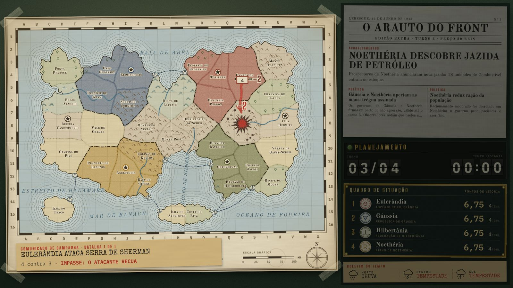
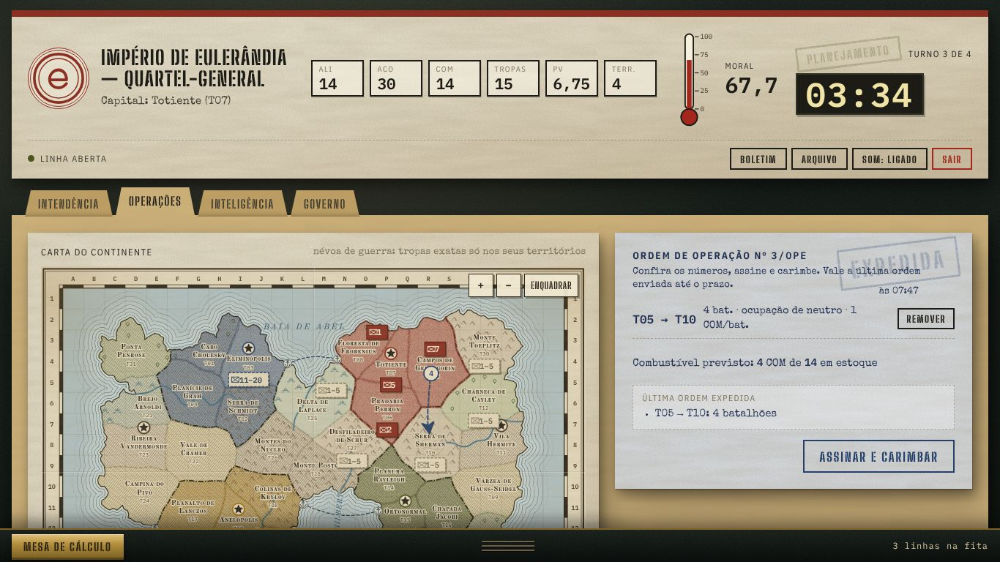
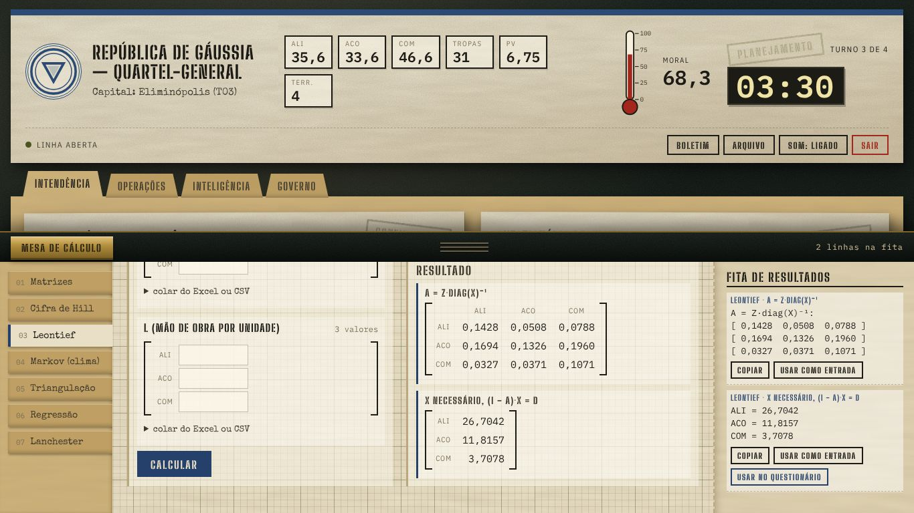
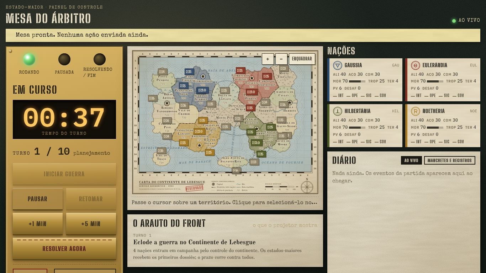

# ESTADO-MAIOR

**ESTADO-MAIOR** é um jogo de guerra educativo, feito para o Simpósio. Quatro nações fictícias disputam
o Continente de Lebesgue, turno a turno. Cada equipe administra a economia, as operações militares, a
inteligência e o governo da sua nação, e precisa usar matemática de verdade (matrizes, cadeias de Markov,
cifra de Hill, regressão) para tomar decisões. O árbitro conduz a partida num painel próprio, e um telão
mostra o teatro de operações. As regras completas estão em [docs/DESIGN.md](docs/DESIGN.md).

O jogo roda num **PC servidor**. Os outros computadores da mesma rede (Wi-Fi ou cabo) acessam o jogo
pelo navegador. Não é preciso instalar nada nos computadores das equipes.

## Capturas

Imagens de uma partida real (4 nações, jogada pela interface). As demais estão em [docs/capturas/](docs/capturas/).

| | |
|---|---|
|  |  |
| **Teatro de Operações** (projetor): o comunicado de campanha acompanha a batalha | **Operações**: carta com névoa de guerra, ordens de marcha por clique e zoom |
|  |  |
| **Mesa de Cálculo**: a fita de resultados leva a resposta direto ao questionário | **Árbitro**: relógio, nações, diário e ferramentas |

## Como rodar no PC servidor

1. **Instale o Docker.**
   - Windows ou macOS: instale o [Docker Desktop](https://www.docker.com/products/docker-desktop/) e
     deixe-o aberto.
   - Linux: instale o Docker Engine e o plugin `docker compose`.
2. **Baixe ou copie esta pasta** para o computador (o nome da pasta não importa).
3. **Abra um terminal dentro da pasta** do projeto (no Windows: clique com o botão direito na pasta e
   escolha "Abrir no Terminal"; ou use `cd` até a pasta).
4. **Suba o servidor:**
   ```
   docker compose up -d --build
   ```
   A primeira vez demora alguns minutos. Depois disso o jogo fica no ar em segundo plano, e volta sozinho
   se o computador reiniciar.

### Trocar a senha do árbitro

A senha padrão é `arbitro`. Troque-a antes do evento. Em macOS ou Linux:

```
ADMIN_PASSWORD=sua-senha-nova docker compose up -d
```

No Windows (PowerShell):

```
$env:ADMIN_PASSWORD="sua-senha-nova"; docker compose up -d
```

Também é possível criar um arquivo chamado `.env` na pasta do projeto, com a linha
`ADMIN_PASSWORD=sua-senha-nova`. O Docker lê esse arquivo sozinho.

## Como descobrir o IP do PC servidor

Os outros computadores precisam do endereço IP do servidor na rede local (algo como `192.168.0.25`).

- **Windows:** no terminal, rode `ipconfig` e procure "Endereço IPv4" do adaptador que está em uso.
- **macOS:** no terminal, rode `ipconfig getifaddr en0` (se não aparecer nada, tente `en1`).
- **Linux:** no terminal, rode `hostname -I` e use o primeiro endereço.

### Liberar a porta 8000 no firewall (Windows)

Sem isso, os outros computadores não conseguem entrar. Abra o **Windows PowerShell como
administrador** e rode:

```
netsh advfirewall firewall add rule name="Estado-Maior" dir=in action=allow protocol=TCP localport=8000
```

No macOS e no Linux, normalmente nada precisa ser feito. Se houver um firewall ativo, libere a porta 8000.

## Endereços

Troque `IP` pelo endereço descoberto acima. No próprio PC servidor, use `localhost` no lugar do IP.

| Endereço | Para quem | Uso |
|---|---|---|
| `http://IP:8000/` | Equipes | Portão das nações: cada equipe entra com a sua senha |
| `http://IP:8000/teatro` | Projetor | Mapa ao vivo, para todos verem |
| `http://IP:8000/arbitro` | Árbitro | Painel de controle da partida (senha do árbitro) |

## Parar, reiniciar e zerar

| O que fazer | Comando |
|---|---|
| Parar o jogo (os dados ficam guardados) | `docker compose down` |
| Ligar de novo (depois de parar) | `docker compose up -d` |
| Reiniciar o servidor | `docker compose restart` |
| Ver o que está acontecendo (para diagnosticar) | `docker compose logs -f` |
| **Zerar a partida** (apaga todos os dados da partida) | `docker compose down -v` |

Atenção: `docker compose down -v` apaga a partida em andamento de forma definitiva. Use-o só para começar
do zero.

## Rodar sem Docker (desenvolvimento)

É preciso Python 3.12 ou mais novo.

```
pip install -r server/requirements-dev.txt
cd server
uvicorn app.main:app --reload
```

Depois, abra `http://localhost:8000/`. Os testes rodam com:

```
cd server
python -m pytest
```

Sem Docker, os dados da partida ficam na pasta `data/` da raiz do repositório.

## Estrutura do repositório

| Pasta ou arquivo | Conteúdo |
|---|---|
| `docs/` | Documentação: regras do jogo (`DESIGN.md`), contrato técnico (`CONTRATO.md`), plano de trabalho (`PLANO.md`) |
| `server/` | Servidor em Python (FastAPI). `server/app/engine/` tem a matemática pura; `server/app/game/` tem as regras; `server/tests/` tem os testes |
| `web/` | Telas do jogo em HTML, CSS e JavaScript puro (sem instalação). `web/fonts/` tem as fontes, que vêm junto para funcionar sem internet |
| `tools/` | Ferramentas para os jogadores (Mesa de Cálculo) e geração do mapa |
| `Dockerfile`, `docker-compose.yml` | Receita para rodar tudo num contêiner Docker |

Para entender como as partes se conectam, leia [docs/CONTRATO.md](docs/CONTRATO.md). Para o cronograma e
a divisão de trabalho, leia [docs/PLANO.md](docs/PLANO.md).
